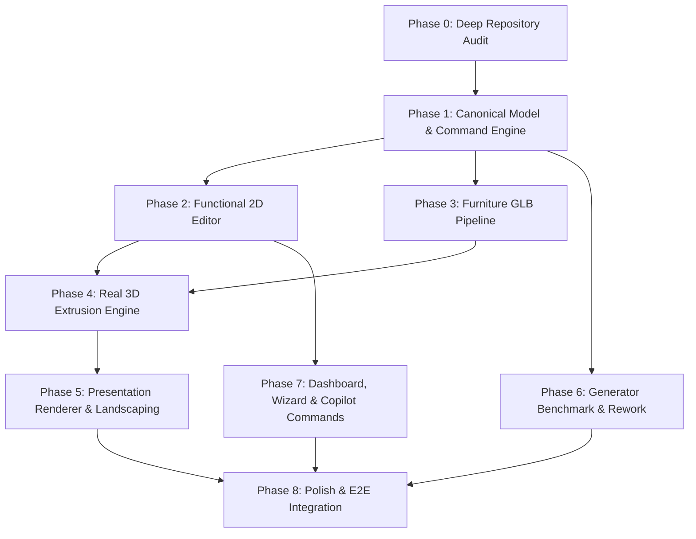

# AI Architect — Architectural Decision Record & Target Architecture (Phase 0)

*Date: October 11, 2026*  
*Status: Proposed & Under Review*  
*Corresponds to: AI_Architect_Antigravity_Package.md & AGENTS.md*

---

## 1. Context & Architectural Problem Statement

The Phase 0 repository audit revealed a critical architectural dichotomy:
- **The Strengths:** The application features a modern, functional full-stack setup (FastAPI + React 19 + Vite 8), verified multi-tier advisory engines (Vastu, NBC, Daylight, BOM), functional CAD/PDF exporters, and an active Three.js 3D viewport.
- **The Structural Flaw:** The underlying spatial model is **not a building model**; it is an untyped list of axis-aligned rectangles. Walls do not exist as graph edges; doors and windows are floating offsets on room borders; furniture in 3D is hardcoded procedural boxes; and manual 2D resizing is an ad-hoc delta-matching script that frequently produces invalid geometry and lacks undo/redo integration.

To fulfill the product vision ("generate a building the user can actually work with, not merely an image of a building"), the platform must transition to a **single authoritative, versioned building document** from which all views (2D drafting, 3D viewport, presentation render, advisory analyses, and exports) are pure projections.

---

## 2. Retain vs. Improve vs. Replace Decisions

Every decision below is justified by direct evidence from the repository audit:

| Subsystem | Decision | Repository Evidence & Justification | Alternatives Considered & Why Rejected |
| :--- | :--- | :--- | :--- |
| **2D Engine** | **IMPROVE (Retain SVG, Replace Interaction Layer)** | `InteractiveBlueprint.tsx` already renders clean SVG vectors at 60 FPS. The bottleneck is not SVG rendering; it is state mutation via `JSON.parse(JSON.stringify())` on every mousemove, and the absence of a command controller. | *Canvas / Konva:* Would require rewriting SVG styling, custom typography, defs, and exports with no measured rendering performance benefit for scenes under 1,000 DOM elements. |
| **3D Engine** | **IMPROVE (Retain Three.js / R3F, Refactor Architecture)** | `FloorPlan3D.tsx` already uses Three.js (`0.185.1`), `@react-three/fiber` (`9.7.0`), and `@react-three/drei` (`10.7.8`). However, the monolithic 2,598-line component violates React Rules of Hooks (lines 1552-1565) and duplicates walls per room. | *Babylon.js:* Unnecessary second 3D runtime that would inflate bundle size without benefit. *Pure Three.js without R3F:* R3F integrates well with React 19; fixing the hook violations and modularizing into extruded wall shapes resolves all issues. |
| **Geometry Model** | **REPLACE (Room Rectangles → Canonical Wall Graph)** | The current data model (`api.ts:40-49`) has zero concept of walls or shared nodes. Resizing one room cannot mathematically update shared partition walls or openings without an explicit wall graph. | *Retaining bounding boxes:* Cannot support non-rectangular rooms, shared wall thickness, opening constraints, or IFC/BIM interoperability. |
| **Furniture System**| **REPLACE (Procedural Boxes → Real GLB Asset Pipeline)** | Zero 3D model files exist; thumbnails are Lucide icon names (`furnitureCatalog.ts`). Procedural boxes cannot achieve the visual realism required for residential architectural presentation. | *Keeping procedural 3D boxes:* Look crude, cannot represent complex fixtures (Indian pooja units, ergonomic office chairs, sanitaryware), and cannot produce rendered thumbnails. |
| **Generation Engine**| **IMPROVE (3-Bay Partitioner → Seeded Hybrid Constraint Solver)**| The deterministic drafter (`architectural_layout.py`) provides an overlap-free baseline but is strictly locked to a 3-bay vertical stack. It will be retained as the baseline while building a 50-plot benchmark suite to evaluate constraint-based layouts. | *Pure LLM coordinate generation:* Proven to hallucinate overlaps and unbuildable geometry. *Pure OR-Tools CP-SAT:* High implementation complexity before benchmarking whether simple topological heuristics suffice. |
| **State & Undo** | **IMPROVE (Custom Stack + Command Pattern)** | `Editor.tsx` has a basic `history: Floor[][]` that is bypassed by direct 2D edits. We will implement an explicit Command Pattern with forward execute, candidate validation, and inverse patches. | *Adding Redux / Zustand:* Unnecessary overhead when React state + an explicit Command History class is cleaner and lighter. |
| **Persistence** | **IMPROVE (Untyped Dict → Versioned Schema + Importer)** | `repositories.py` and `models.py` accept untyped `dict`. We must introduce `schemaVersion: 1`, pure migration functions, and a legacy importer so existing saved projects load seamlessly. | *Dropping legacy support:* Risks breaking existing saved projects. |

---

## 3. The Canonical Building Data Model

### 3.1 Units and Coordinate System
- **Dimensional Units:** Floating-point **metres (`m`)** stored to 3 decimal places (millimetre precision), converted to **feet (`ft`)** only at the UI display and input boundary.
- **Coordinate Convention:** Right-handed Cartesian coordinates:
  - **X:** East (+X) / West (-X)
  - **Y:** Elevation (+Y is Up in 3D)
  - **Z:** North (+Z) / South (-Z) (mapped from 2D canvas `y`).
- **Rotation:** Counter-clockwise degrees `[0, 360)` about the vertical axis.

### 3.2 Canonical Document Schema (`CanonicalBuildingDocument`)

```typescript
export interface CanonicalBuildingDocument {
  schemaVersion: 1;
  id: string;
  metadata: {
    name: string;
    createdAt: string;
    updatedAt: string;
    generatorSeed?: string;
    entryDirection: 'north' | 'south' | 'east' | 'west';
    displayUnits: 'ft' | 'm';
  };
  site: {
    plotPolygon: Point2D[]; // in metres
    entrySide: 'north' | 'south' | 'east' | 'west';
    northAngle: number;     // degrees offset from +Z
    setbacks: { front: number; rear: number; left: number; right: number };
  };
  levels: Level[];
}

export interface Level {
  id: string;
  levelIndex: number;
  name: string;
  elevation: number;    // metres above ground
  height: number;       // ceiling height in metres (standard 3.05m = 10ft)
  slabThickness: number;// floor slab thickness (0.25m)
  nodes: WallNode[];
  walls: Wall[];
  openings: Opening[];
  rooms: CanonicalRoom[];
  items: PlacedItem[];
  stairs: Staircase[];
}

export interface WallNode {
  id: string;
  x: number; // metres
  y: number; // metres (corresponds to site 2D plane)
}

export interface Wall {
  id: string;
  startNodeId: string;
  endNodeId: string;
  thickness: number; // metres (exterior: 0.23m / 9in; interior: 0.115m / 4.5in)
  height: number;    // metres
  kind: 'exterior' | 'interior' | 'parapet' | 'partition';
  materialId?: string;
}

export interface Opening {
  id: string;
  wallId: string;
  offset: number;     // metres along wall from startNode
  width: number;      // metres (standard door: 0.9m / 3ft)
  height: number;     // metres (standard door: 2.1m / 7ft)
  sill: number;       // metres above floor (doors: 0m; windows: 0.9m)
  type: 'single_door' | 'double_door' | 'sliding_door' | 'window' | 'opening';
  swing?: 'inward_left' | 'inward_right' | 'outward_left' | 'outward_right';
}

export interface CanonicalRoom {
  id: string;
  name: string;
  roomType: string;
  boundaryNodeIds: string[]; // ordered closed loop of WallNodes forming room perimeter
  materialId?: string;
  // Note: area, centroid, and adjacency are DERIVED selectors, never authoritative truth
}

export interface PlacedItem {
  id: string;
  assetId: string;           // points to AssetRegistry
  x: number;                 // site coordinates in metres
  y: number;
  elevation: number;         // metres above floor
  rotation: number;          // degrees
  scale?: [number, number, number];
  locked: boolean;
}
```

---

## 4. 2D Editing Engine & 3D Rendering Architecture

### 4.1 2D Editing Architecture
- **Rendering Layer:** Native React SVG with layered rendering groups:
  1. `<g className="site-layer">`: Plot boundary, setbacks, survey grid, north arrow.
  2. `<g className="rooms-fill-layer">`: Polygon fills from derived room loops with tactile washes.
  3. `<g className="walls-layer">`: Offset wall polygons with genuine physical wall thickness.
  4. `<g className="openings-layer">`: Door openings (wall gaps + swing arcs) and window double-lines.
  5. `<g className="furniture-layer">`: 2D item footprints rendered from catalog asset registry.
  6. `<g className="interaction-layer">`: Wall node handles, midpoint extrusion handles, snapping guides, selection bounding boxes.
- **Interaction Controller:**
  - Pointer events capture mouse moves via `setPointerCapture`.
  - While dragging a wall node: only the candidate document is calculated in memory; the canvas updates smoothly without React component re-rendering tree churn.
  - On pointer release: candidate document is passed to the **Validator Pipeline**. If valid, the command is committed and recorded in the Undo stack. If invalid, the edit reverts with a specific, actionable notification.

### 4.2 3D Rendering Architecture
- **Wall Extrusion without CSG:**
  - Walls are extruded as Three.js `ShapeGeometry` directly from the wall line, thickness, and height.
  - Doors and windows are represented as holes in the wall shape path (`shape.holes.push(...)`). This completely avoids heavy and unstable Constructive Solid Geometry (CSG) boolean operations in WebGL.
- **Room Floor Slabs:**
  - Extruded directly from the derived room polygon `boundaryNodeIds` using `THREE.ShapeGeometry` + Earcut triangulation.
- **Resource Lifecycle & Leak Prevention:**
  - Every Three.js geometry, material, and texture is tracked and explicitly disposed on unmount or scene recreation (`geometry.dispose()`, `material.dispose()`).
  - Conditional hook calls in `FloorPlan3D.tsx` are refactored into distinct child components (`RoomMesh`, `WallSegmentMesh`) adhering strictly to the Rules of Hooks.

---

## 5. Geometry Operations, Validation, and Undo/Redo

### 5.1 Command Pattern & Undo/Redo
All mutations must occur through atomic commands:
```typescript
interface Command {
  id: string;
  name: string;
  execute: (doc: CanonicalBuildingDocument) => CanonicalBuildingDocument;
  inverse: (doc: CanonicalBuildingDocument) => CanonicalBuildingDocument;
}
```
Supported Commands:
- `MoveWallNode(nodeId, newX, newY)`: Updates node position, propagates to all incident walls, updates connected room loops and wall-attached openings.
- `SplitWall(wallId, splitPoint)`: Inserts a new node, splits wall into two segments.
- `AddOpening(wallId, offset, spec)`: Validates clearance and attaches opening.
- `MoveOpening(openingId, newOffset)`: Validates offset against wall length and corner clearances.
- `PlaceItem(assetId, x, y, rotation)`: Inserts furniture item.
- `TransformItem(itemId, newX, newY, newRotation)`: Moves/rotates item without altering walls.
- `DeleteItem(itemId)` / `DeleteOpening(openingId)`: Reversible deletions.

### 5.2 Validator Pipeline
Candidate documents must satisfy all validators before committing:
1. **Wall Non-Crossing:** No wall edges intersect except at declared shared `WallNodes`.
2. **Opening Fit:** Opening length (`width`) plus 0.15m corner clearance fits within wall length.
3. **Room Overlap:** Derived room polygons have zero intersection area.
4. **Minimum Dimensions:** All habitable rooms maintain min dimension ≥ 2.4m (8ft).
5. **Plot Containment:** All walls and rooms remain within plot polygon minus setbacks.
6. **Circulation Reachability:** All habitable rooms are reachable from the entrance via the door graph.

---

## 6. Furniture Asset Pipeline & Honest Catalog

### 6.1 Format & Optimization
- **3D Format:** Binary glTF (`.glb`), optimized using Draco geometry compression and KTX2 texture compression.
- **Storage:** Placed in `frontend/public/assets/furniture/models/`.
- **2D Footprints:** Derived 2D vector footprints stored in the registry for crisp drafting rendering.

### 6.2 Headless Thumbnail Generator
- Script: `scripts/generate_furniture_thumbnails.ts` (using headless Three.js / Puppeteer).
- Generates 256×256 WebP rendered thumbnails with consistent isometric camera, neutral studio lighting, and soft drop shadows.
- Saved to `frontend/public/assets/furniture/thumbnails/`.

### 6.3 Honest Asset Registry (`furnitureRegistry.json`)
Every asset must record:
```json
{
  "id": "kenney_bed_double",
  "name": "Double Bed",
  "category": "Bedroom",
  "dimensions": { "width": 1.6, "depth": 2.0, "height": 0.9 },
  "glbPath": "/assets/furniture/models/bed_double.glb",
  "thumbnailPath": "/assets/furniture/thumbnails/bed_double.webp",
  "license": "CC0 1.0 Universal",
  "source": "https://opengameart.org/content/furniture-kit",
  "attribution": "Kenney Vleugels (Kenney.nl)"
}
```
- Custom parametric procedural models will be used only for categories missing from CC0 sources (e.g. Indian Pooja Mandir, regional kitchen configurations).

---

## 7. Presentation Mode Architecture

The presentation mode will bridge technical CAD drafting and client-ready architectural visuals:
- **Renderer:** Same Three.js scene, switched to an orthographic top-down camera with high-resolution canvas render target.
- **Visual Features:**
  - Visible solid wall thickness with dark ink fill.
  - Room floor materials (hardwood, marble, slate, tile) with bump mapping.
  - PCF-soft shadows and directional sunlight tuned to the building's geographic orientation.
  - Parametric Landscaping:
    - Lawn polygon derived from `plotPolygon` minus building footprint.
    - Boundary hedges along plot edges.
    - Flagstone walkway from site entrance to front door.
    - CC0 low-poly trees and shrubs placed in setback garden zones.
- **Export:** High-resolution PNG export (1080p, 2K, 4K) via WebGL canvas `toDataURL()`.

---

## 8. Persistence & Database Architecture: Verified Supabase Integration

### 8.1 Primary Database Architecture: Supabase PostgreSQL
The project's authoritative cloud database architecture is **Supabase PostgreSQL**, integrated across both frontend and backend layers:

1. **Frontend Integration (`frontend/src/shared/api-client/supabase.ts` & `AuthContext.tsx`):**
   - Client: `@supabase/supabase-js` (`^2.117.3`).
   - Environment variables: `VITE_SUPABASE_URL` and `VITE_SUPABASE_PUBLISHABLE_KEY` (or `VITE_SUPABASE_ANON_KEY`).
   - Auth lifecycle: When `VITE_AUTH_PROVIDER=supabase`, `supabase.auth.getSession()` retrieves active sessions, `onAuthStateChange` synchronizes tokens, and the access token is passed in `Authorization: Bearer <token>` for all API requests.
2. **Backend PostgREST & Auth Layer (`backend/db/supabase_client.py` & `backend/core/auth.py`):**
   - Client: Async HTTP PostgREST driver (`httpx`) targeting Supabase REST (`/rest/v1/`) and Auth (`/auth/v1/`) endpoints.
   - Environment variables: `SUPABASE_URL`, `SUPABASE_DB_URL`, `SUPABASE_SERVICE_ROLE_KEY`, `SUPABASE_JWT_SECRET`.
   - Token verification: `core/auth.py:get_current_user()` decodes tokens via `SUPABASE_JWT_SECRET` (HS256) or queries `https://<project>.supabase.co/auth/v1/user` directly.
3. **Verified Supabase PostgreSQL Table Schema:**
   - **`public.projects`**: Primary project table.
     - `id` (UUID, Primary Key)
     - `user_id` (UUID, Foreign Key to `auth.users`)
     - `name` (TEXT)
     - `plot_width` (NUMERIC/FLOAT)
     - `plot_length` (NUMERIC/FLOAT)
     - `measurement_unit` (TEXT, 'ft' or 'm')
     - `entry_direction` (TEXT, 'north'|'south'|'east'|'west')
     - `budget_target` (NUMERIC, nullable)
     - `layout_data` (JSONB): Authoritative building document payload.
     - `building_preferences` (JSONB): Form inputs and generation options.
     - `image_url` (TEXT, nullable): Preview image.
     - `description` (TEXT, nullable)
     - `created_at` / `updated_at` (TIMESTAMPTZ)
   - **`public.project_versions`**: Immutable design history snapshots.
     - `id` (UUID, Primary Key)
     - `project_id` (UUID, Foreign Key to `public.projects`)
     - `version_number` (INTEGER)
     - `commit_message` (TEXT)
     - `snapshot` (JSONB): Immutable snapshot of `layout_data`.
     - `created_by` (UUID)
     - `created_at` (TIMESTAMPTZ)
   - **`public.furniture_placements`**: Synchronized placed items.
     - `project_id` (UUID), `floor_level` (INT), `room_name` (TEXT), `catalog_id` (TEXT), `name` (TEXT), `x`, `y`, `width`, `height`, `rotation` (NUMERIC), `properties` (JSONB).
   - **`public.lighting_fixtures`**: Synchronized lighting elements.
     - `project_id` (UUID), `floor_level` (INT), `room_name` (TEXT), `name` (TEXT), `x`, `y` (NUMERIC), `properties` (JSONB).
   - **`public.design_conversations`** & **`public.conversation_messages`**: Conversational design history for AI Copilot.

### 8.2 Dual-Provider Coexistence (MongoDB Legacy/Fallback)
- In `backend/db/repositories.py` and `database.py`, MongoDB logic (`MongoProjectRepository`) acts as a secondary provider / offline fallback controlled by `DATABASE_PROVIDER=mongodb`.
- In accordance with project instructions, **MongoDB code will NOT be removed or disrupted**. It is preserved alongside Supabase PostgREST repositories.
- Neither database provider configuration will be overwritten, invented, or exposed.

### 8.3 Canonical Building Document Storage in Supabase
- Because `public.projects.layout_data` and `public.project_versions.snapshot` are **JSONB columns**, PostgreSQL natively stores the new versioned `CanonicalBuildingDocument` (`schemaVersion: 1`) without requiring any breaking database schema changes.
- To ensure 100% backward compatibility with all existing exports and components:
  ```json
  {
    "schemaVersion": 1,
    "canonical": { /* CanonicalBuildingDocument */ },
    "floors": [ /* Derived projection for existing UI and exporters */ ]
  }
  ```

### 8.4 Proposed Optional SQL Migration (Non-Breaking, Under Review)
If the user desires explicit top-level SQL queryability for schema versions or canonical metadata in Supabase PostgreSQL, the following non-breaking migration is proposed for review:

```sql
-- Migration Proposal: Add optional schema_version and canonical_model columns
-- Impact: Non-breaking; leaves all existing layout_data and project_versions intact.

ALTER TABLE public.projects 
  ADD COLUMN IF NOT EXISTS schema_version INTEGER DEFAULT 1;

ALTER TABLE public.projects 
  ADD COLUMN IF NOT EXISTS canonical_model JSONB;

-- Comment documenting the canonical building model version
COMMENT ON COLUMN public.projects.canonical_model IS 
  'Authoritative CanonicalBuildingDocument (schemaVersion 1, SI units)';
```
*Note: This migration is completely optional because the existing `layout_data` and `snapshot` JSONB columns already support versioned JSON.*

### 8.5 Legacy Project Importer
When loading a project from Supabase (`projects.layout_data` or `project_versions.snapshot`):
1. If `schemaVersion === 1`, load directly into the Canonical Model.
2. If `schemaVersion` is absent or 0 (legacy format with `rooms` or `floors`), execute `migrateLegacyToCanonical(legacyLayout)`:
   - Extract room rectangles.
   - Synthesize topological `WallNodes` and `Walls` along room borders and shared partitions.
   - Map `doors` and `windows` to host walls with calculated offsets.
   - Preserve original legacy JSON in `legacySnapshot` to guarantee zero data loss.

---

## 9. Implementation Phasing & Dependencies



---

## 10. Technical Risks & Mitigation Strategies

1. **Risk:** Breaking backend DXF and PDF exporters when changing from room rectangles to wall graph.  
   *Mitigation:* Retain a pure projection selector `canonicalToLegacyFloors(doc)` that outputs the legacy `{floors: [{rooms: [...]}]}` structure, allowing existing exporters to function unchanged while the core is upgraded.
2. **Risk:** Performance degradation during wall-node dragging in 2D SVG.  
   *Mitigation:* Decouple drag feedback from React state; update temporary SVG handles via direct DOM attributes during drag, committing to React state only on pointer-up.
3. **Risk:** WebGL memory leaks during repeated 2D ↔ 3D mode switching.  
   *Mitigation:* Implement strict GPU resource disposal in R3F `useEffect` cleanup handlers.
4. **Risk:** Supabase / MongoDB dual-provider drift.  
   *Mitigation:* Keep repository dispatching in `repositories.py:get_project_repository()` clean and uniform; both providers store the exact same versioned `layout_data` JSON payload.

